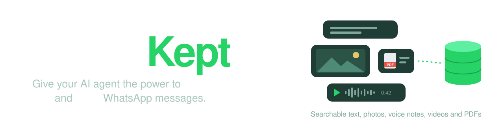
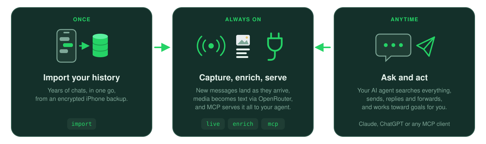

<p align="center">
  
</p>

<p align="center">
  <a href="https://github.com/alkait/whatskept/releases"></a>
  
  
  <a href="LICENSE"></a>
</p>

## What is WhatsKept?

WhatsKept turns your WhatsApp, years of history plus every new message, into
one searchable database on your machine, including what's inside photos, voice
notes, videos and PDFs. Over MCP, your AI agent can search it and message from
your account:

- *"What did the plumber quote for the bathroom? It might be in a voice note."*
- *"Forward the boarding passes from the travel group to my brother."*
- *"Reply to the school's trip message: count us in."*
- *"Find a date that works for the book club, then send everyone the invite."*
- *"Chase everyone who still owes for the birthday gift until they've all paid."*

## Audit

Not sure you can trust it? Have your agent check first:

```
trace the latest release of https://github.com/alkait/whatskept to the source commit it
was built from and audit that code: should I trust this with my privacy and my WhatsApp data?
```

## Installation

WhatsKept is installed and operated by your AI agent. Paste this into
[Claude Code](https://claude.com/claude-code):

```
install the latest release of https://github.com/alkait/whatskept and put it on my PATH.
When done, ask me one question — where my workspace is, or where I'd like a new one —
then tell me to continue in a new terminal and print the matching command with my path
filled in:

  New workspace:      mkdir -p <path> && cd <path> && whatskept init && claude "Hi"
  Existing workspace: cd <path> && claude "Hi"
```

Say "Hi" in the new terminal, and the agent walks you through the rest:
importing your backup, enriching media, live capture and connecting your AI
client 😊

## Uninstall

```
uninstall WhatsKept from my computer
```

## How it works

<p align="center">
  
</p>

WhatsKept is a single binary. Everything lives in a **workspace**: a folder
created by `whatskept init`, holding the database, a `.whatskept/` settings
folder and a guide (`AGENTS.md`) that teaches your agent to operate it. Live
capture and sending use [whatsmeow](https://github.com/tulir/whatsmeow), which
links WhatsKept to your account as a companion device, the same way WhatsApp
Web does.

| Command | What it does |
|---|---|
| `whatskept init [dir]` | Create a workspace. |
| `whatskept import <backup>` | Import full history from an encrypted iPhone backup. Resumable. `--list` finds backups. |
| `whatskept enrich` | Turn queued photos, voice notes, videos and PDFs into text via OpenRouter. Resumable. |
| `whatskept live` | Link as a WhatsApp companion device (scan a QR once) and capture new messages. |
| `whatskept send <chat> <text>` | Send through the running `live`. Supports `--reply-to` and `--forward`. |
| `whatskept mcp --database <file>` | Serve the database over MCP at `/mcp`, behind a bearer token. |

## Privacy & security

| Concern | How WhatsKept handles it | Your responsibility |
|---|---|---|
| **Where does my data live?** | In one SQLite file in your workspace, on your computer or a server you run. There is no WhatsKept service, account or telemetry. | Keep that machine secure. |
| **Who gets my photos, videos, voice notes and PDFs?** | [OpenRouter](https://openrouter.ai), only when you enrich. Media goes out, text comes back, and the local file is deleted. | Decide whether OpenRouter is acceptable for your media. If not, don't enrich. |
| **What does my AI provider see?** | Only what your agent reads through MCP. | Use an AI provider you trust with your chats. |
| **Who can reach the MCP server?** | Only requests carrying your bearer token. | Keep the token secret. |
| **Can I trust the binary?** | Every release is built by GitHub Actions from a public commit. | Run the [Audit](#audit) prompt before you install, or build it yourself from source. |

## Development

```sh
go test ./...                              # everything; no phone, key or network needed
go build -o whatskept ./cmd/whatskept
```

Real end-to-end tests run against a second WhatsApp number and are gated
behind the `e2e` build tag:

```sh
go run ./cmd/whatsapp-tester pair                          # one-time: pair the tester number
go test -tags e2e ./e2e-test -workspace <dir>              # with `whatskept live` running there
go test -tags e2e ./e2e-test -workspace <dir> -enrich      # also the paid enrichment scenarios
```

## Contributing

Issues and ideas are welcome. Before a pull request, open an issue so we can
agree on the change. Keep it small, and keep `go test ./...` green.

## License

[MIT](LICENSE)
